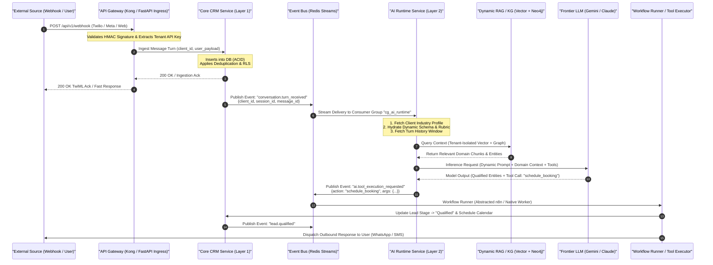
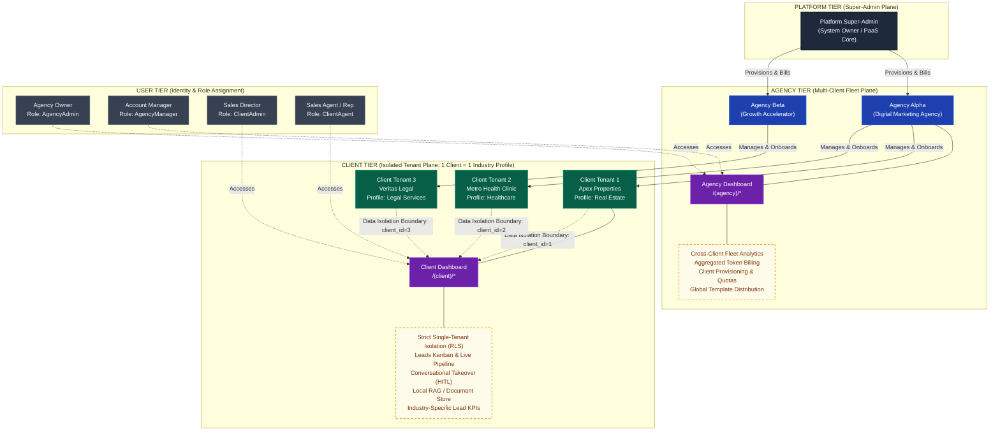

# Unified AI Revenue Automation Platform (PaaS)
## System Architecture & Service Boundaries Document (Schema V2)

| Field | Detail |
| :--- | :--- |
| **Document ID** | ARCH-SPEC-V2.0 |
| **Document Status** | Approved for Architecture Sprint |
| **Author** | Platform Architect |
| **Target Audience** | Backend Lead, Frontend Lead, DevOps/Infra Lead, Platform Engineering |
| **System Version** | PaaS Engine v2.0 (Multi-Tenant, Dynamic Profile AI Core) |

---

## 1. Executive Summary & Architectural Tenets

The **Unified AI Revenue Automation Platform (PaaS)** is a multi-tenant, enterprise-grade cloud operating system designed to ingest, qualify, engage, and convert inbound/outbound commercial demand across diverse commercial verticals. 

### 1.1 Core Architectural Principles

1. **Strict Decoupling of Layers**:
   - **Layer 1 (Core Platform)** handles all deterministic, synchronous, ACID-compliant transactions (tenancy, authentication, billing, CRM, audit).
   - **Layer 2 (AI Core)** handles all non-deterministic, probabilistic, asynchronous, and LLM-driven reasoning (intent resolution, context assembly, multi-agent dispatch, tool execution).
2. **Zero Hardcoded Industry Logic (Dynamic Context Injection)**:
   - The platform core contains zero references to specific vertical domains (e.g., real estate, healthcare, legal, or automotive).
   - Every client tenant maps strictly to **1 Industry Profile**. Industry Profiles define extraction schemas, scoring rubrics, conversational guidelines, ontology taxonomies, and tool definitions. The AI Runtime injects these profiles at runtime dynamically based on tenant resolution.
3. **Four-Tier Hierarchy Isolation**:
   - The tenancy model enforces hierarchical tenancy: `Platform -> Agency -> Client -> User`.
   - Security boundaries and Row-Level Security (RLS) prevent cross-tenant data leaks while enabling aggregate analytical roll-ups for agency and platform operators.
4. **Abstracted Automation Plane**:
   - Workflow automation engines (such as n8n or internal DAG runners) are decoupled from the core platform through an abstracted `WorkflowRunner` interface and asynchronous event streams. The domain core never depends on third-party automation vendors.

---

## 2. High-Level System Architecture: Layer 1 vs. Layer 2

```
+====================================================================================================+
|                                    LAYER 1: CORE PLATFORM                                          |
|                               (Deterministic / ACID / Multi-Tenant)                               |
+====================================================================================================+
|  [Auth & RBAC]             [Tenant Management]          [Core CRM]              [Usage & Billing]  |
|  - JWT / OAuth2 / API Keys - 4-Tier Hierarchy Store     - Leads & Contacts      - Token Metering   |
|  - Tenant Claims Engine    - Industry Profile Registry  - Pipeline & Stages     - Tier Quotas      |
|  - Permission Policies     - Tenant KMS / Crypto Keys   - State Machines & RLS  - Stripe / Credits |
+----------------------------------------------------------------------------------------------------+
                                      | Domain Events (Redis Streams / Kafka)
                                      v
+====================================================================================================+
|                                      LAYER 2: AI CORE                                              |
|                                (Probabilistic / Dynamic / Agentic)                                 |
+====================================================================================================+
|  [Context Builder]         [Multi-Agent Orchestrator]   [RAG Engine]            [Sandboxed Tools]  |
|  - Dynamic Schema Injector - Multi-Agent Router (CEO)   - Hybrid Vector (FAISS) - CRM Read/Write   |
|  - Industry Profile Loader - Intent & Score Evaluator   - Graph KG (Neo4j)      - Calendar Booking |
|  - Sliding Turn History    - SLA / Token Budget Manager - Multi-Tenant RLS RAG  - Outbound Bridge  |
+====================================================================================================+
```

### 2.1 Layer 1: Core Platform (Deterministic Engine)

Layer 1 operates as the authoritative, transactional source of truth. All operations in this layer must guarantee atomicity, consistency, isolation, and durability (ACID).

* **Authentication & RBAC (`AuthService`)**:
  - Issues and validates cryptographically signed JWTs containing tenant claims (`platform_id`, `agency_id`, `client_id`, `user_id`, `role`).
  - Manages tenant-scoped API keys (`X-API-Key`) with automated cryptographic hashing, key rotation, and per-tenant rate limits.
  - Implements fine-grained Role-Based Access Control (RBAC): `PlatformSuperAdmin`, `AgencyAdmin`, `AgencyManager`, `ClientAdmin`, `ClientAgent`.
* **Tenant & Profile Management (`TenantService`)**:
  - Maintains the relational registry of the 4-tier hierarchy.
  - Stores the **Industry Profile Schemas** (JSONSchema / Pydantic models) mapped to each client.
  - Controls lifecycle states (`provisioning`, `active`, `suspended`, `archived`) and encryption envelopes.
* **Core CRM (`CRMService`)**:
  - Encapsulates deterministic business objects: Leads, Accounts, Opportunities, Conversations, Tasks, Activities, and Pipelines.
  - Enforces database-level Row-Level Security (RLS) on PostgreSQL where every tenant-scoped query is constrained by `client_id` (and optionally `agency_id` for roll-ups).
  - Maintains strict state machines for lead lifecycles (e.g., `New -> Contacted -> Qualified -> Proposal -> Won/Lost`).
  - Emits canonical domain events to the Event Bus upon any entity mutation.
* **Usage Metering & Billing (`BillingService`)**:
  - Tracks consumption across three primary dimensions: LLM input/output tokens, vector storage units, and webhook/workflow execution counts.
  - Aggregates usage metrics up through the 4-tier tree: Usage belongs to a `Client`, roll-up belongs to an `Agency`, and settlement occurs against the `Platform` billing engine (Stripe / Invoicing).
  - Enforces hard and soft quotas per tenant tier.

### 2.2 Layer 2: AI Core (Dynamic Intelligence Engine)

Layer 2 executes non-deterministic, probabilistic AI inference and multi-agent coordination. It is completely stateless; state is hydrated on demand from Layer 1 data stores and event payloads.

* **Dynamic Context Builder (`ContextBuilder`)**:
  - **Dynamic Context Hydration**: Reads the client's associated `Industry Profile` and dynamically injects:
    1. Entity Extraction Schemas (e.g., extracting `budget` and `property_type` for real estate; or `symptoms` and `insurance_provider` for healthcare).
    2. Vertical Domain Knowledge (lexicons, tone, objection-handling rubrics).
    3. Action Schemas (available tool definitions matching the industry profile).
  - **Short-Term Memory Assembly**: Retrieves the sliding turn window (last $N$ messages), deduplicates contiguous roles, and summarizes aged interactions.
* **Multi-Agent Orchestrator (`OrchestratorEngine`)**:
  - Evaluates inbound user turns against the dynamically hydrated persona and intent classifiers.
  - Coordinates specialized sub-agents (Qualification, Scoring, Negotiation, Scheduling, Compliance) through an event-driven orchestrator (CEO pattern).
  - Enforces execution guardrails: LLM timeout caps (e.g., 22s hard cap), fallback responses, and cost/token limits.
* **Hybrid Retrieval-Augmented Generation (`RAGEngine`)**:
  - Combines dense vector retrieval (FAISS / pgvector / Qdrant) with structural graph traversal (Neo4j Knowledge Graph).
  - **Tenant Partitioning**: All vector namespaces and graph labels are strictly partitioned by `client_id`. RAG search queries never bridge tenant partitions.
* **Sandboxed Tool Runtime (`ToolExecutor`)**:
  - Translates model tool calls into structured, validated domain requests.
  - Executes tool actions via authenticated service clients against Layer 1 APIs or external providers (Calendar, Messaging, CRM updates).

### 2.3 Layer Interaction Contract

| Property | Layer 1 (Core Platform) | Layer 2 (AI Core) |
| :--- | :--- | :--- |
| **Execution Model** | Deterministic, Synchronous, Transactional | Probabilistic, Asynchronous, Agentic |
| **Data Persistence** | Relational DB (PostgreSQL, ACID, RLS) | Ephemeral in-memory runtime + Cache/Vector |
| **Latency SLA** | $< 50\text{ ms}$ p95 | $< 2500\text{ ms}$ p95 (bounded by LLM budgets) |
| **Vertical Knowledge** | Completely agnostic (Generic Schemas & JSONB) | Dynamically injected via `IndustryProfile` |
| **Communication** | Direct REST / gRPC Internal APIs | Event-Driven (Pub/Sub) + Async Action Invocation |

---

## 3. Microservice Boundaries & Responsibilities

The system is decomposed into five distinct core microservice boundaries:

```
+-------------+      +-------------------+      +------------------+
| API Gateway | ---> | Tenant Management |      |  Core CRM        |
|             |      | Service           |      |  Service         |
+-------------+      +-------------------+      +------------------+
       |                       |                         |
       | HTTP                  | Internal Events         | Domain Events
       v                       v                         v
+------------------------------------------------------------------+
|                    EVENT BUS (Redis Streams)                     |
+------------------------------------------------------------------+
       |                                                 |
       v                                                 v
+------------------+                     +-------------------------+
| AI Runtime       |                     | Workflow Runner         |
| Service          |                     | (n8n Abstracted Bridge) |
+------------------+                     +-------------------------+
```

### 3.1 API Gateway

* **Responsibilities**:
  1. **Ingress & TLS Termination**: Primary entry point for all external traffic (Dashboard Webhooks, Mobile/SPA Clients, Partner Integrations, Third-Party Messaging Webhooks).
  2. **Authentication & Identity Context Stamping**: Validates incoming bearer JWTs or API keys. Injects verified tenant claims into internal request headers:
     - `X-Platform-ID`: UUID
     - `X-Agency-ID`: UUID
     - `X-Client-ID`: UUID
     - `X-User-ID`: UUID
     - `X-User-Role`: String
  3. **Third-Party Signature Verification**: Validates webhook HMAC signatures (Twilio `X-Twilio-Signature`, Meta `X-Hub-Signature-256`, Stripe signatures).
  4. **Rate Limiting & Throttling**: Leaky-bucket / token-bucket rate limiting scoped per `client_id` and per API route to prevent noisy neighbor attacks.
  5. **Circuit Breaking**: Detects downstream service degradation and immediately returns standardized fallbacks (e.g., interim acknowledgment responses).

### 3.2 Tenant Management Service

* **Responsibilities**:
  1. **Hierarchy Master Registry**: Owns the CRUD lifecycle and database schema for `Platform`, `Agency`, `Client`, and `User` entities.
  2. **Industry Profile Repository**: Stores, versions, and serves dynamic `IndustryProfile` specifications. Allows platform and agency admins to publish and update industry taxonomies.
  3. **Quota & License Enforcement**: Manages subscription entitlements, agent seat limits, concurrency caps, and tenant status transitions (`active`, `grace_period`, `suspended`).
  4. **Envelope Key Management (KMS Integration)**: Generates and rotates per-tenant encryption keys for sensitive credentials stored in client configs (e.g., client-specific CRM tokens, WhatsApp credentials).

### 3.3 Core CRM Service

* **Responsibilities**:
  1. **Entity Management**: Manages contacts, leads, accounts, pipeline stages, conversations, and interaction logs.
  2. **Multi-Tenant Data Store**: Hosts PostgreSQL with strict Row-Level Security. Every table includes `client_id` (foreign key indexed) and enforces:
     ```sql
     CREATE POLICY client_isolation_policy ON leads
     FOR ALL TO application_role
     USING (client_id = current_setting('app.current_client_id')::uuid);
     ```
  3. **Deterministic Business Rules**: Stage validation, required contact fields, duplicate lead detection, lead assignment algorithms (round-robin, performance-weighted).
  4. **Domain Event Publication**: Publishes atomic events to the Event Bus upon entity creation, update, or stage transition (e.g., `lead.created`, `lead.qualified`, `lead.stage_updated`).

### 3.4 AI Runtime Service

* **Responsibilities**:
  1. **Context Compilation**: Accepts interaction events, resolves the associated `client_id`, fetches the active `IndustryProfile` from cache, and compiles system prompts and dynamic JSON schemas.
  2. **Inference Orchestration**: Manages the conversational flow using multi-model routing (evaluating query complexity to route between lightweight models and frontier models).
  3. **Memory & RAG Retrieval**: Fetches conversation history and executes tenant-partitioned semantic searches across Vector DB and Knowledge Graph within strict timeout budgets (e.g., 2.0s RAG budget, 0.5s KG budget).
  4. **Tool Generation & Validation**: Formulates tool calls conforming to the `IndustryProfile`'s tool catalog, validates outputs against Pydantic schemas, and dispatches them as Action Requests to the Core CRM or external executors.

### 3.5 Event Bus & The Abstracted Workflow Runner

The platform decouples business workflow automation from the core codebase by introducing an **Abstracted Runner Interface** (`IWorkflowRunner`). This design prevents vendor lock-in to any specific workflow automation tool (e.g., n8n, Temporal, Prefect, or native workers).

```
                             +------------------------+
                             |   Domain Event Bus     |
                             |    (Redis Streams)     |
                             +------------------------+
                                         |
                                         v
                         +-------------------------------+
                         |   Workflow Automation Engine  |
                         +-------------------------------+
                                         |
                                         v
                     +---------------------------------------+
                     |       <<Interface>>                   |
                     |       IWorkflowRunner                 |
                     |  + execute(workflow_id, payload)      |
                     |  + cancel(execution_id)               |
                     |  + get_status(execution_id)           |
                     +---------------------------------------+
                                  /             \
                                 /               \
                                v                 v
         +-----------------------------+   +-----------------------------+
         |    N8nWorkflowRunner        |   |   NativeTaskRunner          |
         | - Dispatches to n8n Webhook |   | - In-Process Python Celery/ |
         | - Translates CloudEvents    |   |   AsyncIO Task Handler      |
         | - Handles Header Auth/HMAC  |   | - Low-latency operations    |
         +-----------------------------+   +-----------------------------+
```

* **Event Bus Implementation**:
  - Implemented using Redis Streams (or Apache Kafka for ultra-high throughput).
  - Stream key architecture: `platform:events` with distinct consumer groups:
    - `cg_crm_sync`: Syncs external CRMs and local state.
    - `cg_ai_runtime`: Triggers background reasoning, scoring, and follow-up arms.
    - `cg_automation_runner`: Listens for workflow-triggering events.
* **Abstracted Workflow Runner (`IWorkflowRunner`) Interface**:
  - Exposes standard lifecycle methods:
    - `trigger_workflow(workflow_id: str, tenant_context: TenantContext, event_payload: dict) -> ExecutionHandle`
    - `get_execution_status(handle: ExecutionHandle) -> ExecutionStatus`
    - `abort_execution(handle: ExecutionHandle) -> bool`
* **n8n Encapsulation (`N8nWorkflowRunner`)**:
  - Sits strictly behind `IWorkflowRunner`.
  - Responsible for:
    - Mapping internal domain event schemas to n8n webhook formats.
    - Managing authentication (e.g., rotating `X-N8N-Header` or `Authorization: Bearer` shared secret tokens).
    - Implementing exponential backoff retries and Dead Letter Queue (DLQ) routing when n8n webhooks fail or experience downtime.
    - Ensuring zero leaky abstractions: Neither the AI Runtime nor the Core CRM has any knowledge of n8n nodes, JSON formats, or webhook URLs.

---

## 4. Dynamic Industry Profile & Context Injection Model

A core architectural invariant of the platform is: **1 Client Tenant = 1 Industry Profile**.

```
+---------------------------------------------------------------------------------------+
|                              CLIENT TENANT RECORD                                     |
|  - client_id: "tenant-c-8902"                                                         |
|  - agency_id: "agency-a-1044"                                                         |
|  - industry_profile_id: "profile-realestate-v2"  <-- DYNAMIC POINTER                  |
+---------------------------------------------------------------------------------------+
                                           |
                                           v
+---------------------------------------------------------------------------------------+
|                               INDUSTRY PROFILE SPEC                                   |
+---------------------------------------------------------------------------------------+
| 1. Entity Extraction Schema:                                                          |
|    - budget (Range/Numeric, Normalizer: Lakhs/Crores/K/M)                             |
|    - location (Geo-entity, Normalizer: Canonical City Directory)                      |
|    - property_type (Enum: Apartment, Villa, Plot, Commercial)                         |
|    - timeline (Enum: Immediate, 1-3 Months, Investment)                               |
|                                                                                       |
| 2. Qualification & Scoring Rubric:                                                    |
|    - Required fields before booking: [budget, location, property_type, name, phone]   |
|    - High-intent trigger: Explicit site visit request or pre-approved financing       |
|                                                                                       |
| 3. Domain Ontology & Vector Namespaces:                                               |
|    - Vector Collection: "tenant_c_8902_knowledge_base"                               |
|    - Graph Node Labels: [:Property], [:Project], [:Amenity], [:Developer]            |
|                                                                                       |
| 4. Tool Catalog:                                                                      |
|    - schedule_site_visit(lead_id, date, project_id)                                   |
|    - send_brochure(lead_id, project_id, delivery_channel)                             |
|    - calculate_emi_estimate(principal, tenor_years)                                   |
+---------------------------------------------------------------------------------------+
```

### 4.1 How Context Injection Works in the AI Runtime

1. **Resolution**: Inbound message arrives at the AI Runtime with `client_id`.
2. **Profile Retrieval**: Context Builder retrieves the `IndustryProfile` from high-speed cache (Redis) or `TenantService`.
3. **Dynamic Prompt Assembly**:
   - The System Prompt is assembled by interpolating the profile's conversational guidelines, tone of voice, and disqualification guardrails into a standardized prompt template.
   - The extraction schema is dynamically converted into structured output definitions (e.g., Gemini / OpenAI JSON Schema Tool declarations).
4. **Dynamic Tool Registration**:
   - The AI Runtime registers only the tools specified in the client's `IndustryProfile`. 
   - When the user asks to schedule an appointment, a Healthcare profile triggers `schedule_doctor_consultation`, whereas a Real Estate profile triggers `schedule_site_visit`. The underlying platform handles these through the generic `CalendarExecutor` tool interface.
5. **Zero Hardcoded Logic Guarantee**:
   - The platform code contains no `if client.industry == "real_estate"` branch statements.
   - All variations in behavior are parameterized within the Industry Profile JSON definitions.

---

## 5. Frontend Architecture & Multi-Tier Dashboards

The frontend is architected as a modern, unified Next.js Application with route groups providing isolated boundaries between the **Agency Dashboard** and the **Client Dashboard**.

```
frontend/src/app/
├── (auth)/
│   ├── login/
│   └── sso/
├── (agency)/                 <--- AGENCY DASHBOARD ROUTE GROUP
│   ├── layout.tsx            <--- Agency Context Provider & Global Nav
│   ├── overview/             <--- Cross-client aggregation, fleet health
│   ├── clients/              <--- Tenant provisioning & lifecycle management
│   ├── billing/              <--- Agency-wide billing, credit distribution
│   └── templates/            <--- Global AI prompts & Industry Profile registry
└── (client)/                 <--- CLIENT DASHBOARD ROUTE GROUP
    ├── layout.tsx            <--- Isolated Client Context & Tenant Scope Guard
    ├── crm/                  <--- Isolated Leads, Kanban, Deals
    ├── conversations/        <--- Live chat, human-in-the-loop takeover
    ├── knowledge/            <--- Client-specific document upload & RAG index
    └── settings/             <--- Local AI fine-tuning & business hours
```

### 5.1 Agency Dashboard vs. Client Dashboard Architecture

| Architectural Dimension | Agency Dashboard (`/(agency)/*`) | Client Dashboard (`/(client)/*`) |
| :--- | :--- | :--- |
| **Target User** | Agency Owner, Account Director, Ops Manager | Client Business Owner, Sales Lead, Sales Rep |
| **Data Access Scope** | Cross-client aggregate: All clients where `agency_id = current_user.agency_id` | Strictly single-tenant: Data where `client_id = current_user.client_id` |
| **Primary KPIs** | Fleet Lead Volume, Aggregate Conversion %, Total Token Consumption, Client ARR/MRR | Pipeline Value, Active Conversations, Unassigned Hot Leads, Visit/Booking Rate |
| **Tenant Control** | Provision/deprovision clients, assign industry profiles, allocate credit pools | Manage local team members, configure office hours, toggle lead auto-pilot |
| **AI Customization Scope** | Agency-wide master prompt templates, baseline compliance guardrails | Local persona tweak, local FAQ document ingestion, prompt tone adjustment |
| **Billing Visibility** | Master invoice, wholesale token costs, client billing margin markups | Monthly platform plan, local credit usage, seat utilization |
| **Security Mechanism** | Middleware verifies `AgencyAdmin` or `AgencyManager` role + `agency_id` scope | Middleware & RLS enforce strict `client_id` boundary; zero cross-tenant leakage |

### 5.2 Frontend Data Access & Isolation Protocol

1. **Authentication Token**: The frontend session is managed via HttpOnly, Secure, SameSite JWT cookies. The JWT encodes the user's tenant context:
   ```json
   {
     "sub": "user_7890",
     "platform_id": "platform_global",
     "agency_id": "agency_1044",
     "client_id": "client_8902",
     "roles": ["ClientAdmin"],
     "exp": 1792348800
   }
   ```
2. **Context Switching for Agency Users**:
   - An Agency Admin possesses an `agency_id` and can view all child `client_id`s.
   - When entering the Client Dashboard view, the agency user selects an active client. The frontend issues an authenticated tenant context switch token or passes the header `X-Target-Client-ID: client_8902`.
   - The backend gateway verifies that `client_8902` belongs to `agency_1044` before executing any query in the client scope.
3. **Data Fetching Architecture**:
   - Server Components (`RSC`) utilize server-side data clients that automatically attach the request's validated tenant context.
   - Real-time updates (incoming messages, lead stage movements) are delivered via Server-Sent Events (SSE) or WebSockets subscribed to tenant-scoped channels (e.g., `events:client_8902`).

---

## 6. Mermaid.js Architectural Diagrams

### 6.1 Diagram 1: Macroscopic Data Flow
*From Webhook Ingestion to API Gateway, Core CRM, Event Bus, AI Runtime, and Tool Execution.*



---

### 6.2 Diagram 2: 4-Tier Tenant Hierarchy & Frontend Dashboard Mapping
*Mapping Platform -> Agency -> Client -> User hierarchy to data access boundaries and dashboard interfaces.*



---

## 7. Production-Grade Non-Functional Requirements (NFRs) & Reliability

### 7.1 Latency Budgets & Webhook Race Handling

When integrating with synchronous messaging webhooks (such as Twilio WhatsApp or Meta Messenger), upstream providers enforce strict HTTP response timeouts ($\le 15\text{ seconds}$). 

| Component | Budget Cap | Action on Expiry |
| :--- | :--- | :--- |
| **API Gateway Ingress** | $10\text{ ms}$ | Immediate return on malformed signature |
| **CRM Ingestion & Lock** | $50\text{ ms}$ | Redis session mutex (`session_lock:{client_id}_{from}`) |
| **RAG Hybrid Retrieval** | $2.0\text{ s}$ | Soft timeout; falls back to raw conversation memory |
| **Graph Context Traversal** | $0.5\text{ s}$ | Soft timeout; falls back to vector context only |
| **LLM Inference** | $22.0\text{ s}$ | Hard cancellation; returns fallback message |
| **Webhook Race Window** | $12.0\text{ s}$ | If inference $> 12\text{s}$, Gateway returns interim ack (`"Checking on that..."`) and schedules outbound response via Event Bus |

### 7.2 Fault Tolerance & Dead Letter Queue (DLQ) Strategy

All event-driven processing must guarantee idempotency and graceful failure degradation:

1. **Idempotency Keys**: All events carry a unique `idempotency_key` (derived from `client_id + message_sid` or `event_id`). Downstream consumers check Redis keys (`ttl = 86400s`) before processing.
2. **Exponential Backoff**: Transient errors (e.g., external LLM rate limits or CRM timeouts) are retried using Tenacity with randomized jitter ($2\text{s} \to 4\text{s} \to 8\text{s} \to 16\text{s} \to 32\text{s}$).
3. **Dead Letter Queue (`DLQ`)**: Failures exceeding 5 retries are routed to the `dlq_events` table with complete stack traces, input payloads, and tenant contexts. An automated replay daemon (`dlq_replay.py`) allows operators to re-inject resolved events back into the active stream.

### 7.3 Data Isolation & Cryptographic Partitioning

1. **Database Multi-Tenancy**: Shared database, separate rows with PostgreSQL Row-Level Security (RLS). Every query must pass `client_id` through session context parameters.
2. **Vector Space Partitioning**: FAISS indices and vector stores maintain separate indexes or hard metadata filtering predicates (`filter={"client_id": client_id}`).
3. **Knowledge Graph Partitioning**: Graph nodes enforce tenant scoping labels (`(:Lead {client_id: "..."})`). Cypher queries explicitly filter by `client_id` at every match step.
4. **Data at Rest & in Transit**: AES-256 encryption at rest; TLS 1.3 in transit. Sensitive client API keys (CRM credentials, WhatsApp secrets) are envelope-encrypted using tenant-specific Data Encryption Keys (DEKs) managed by the Tenant Management Service.

---

## 8. Summary & Next Steps for Architecture Sprint

This specification establishes the structural contract for the **Schema V2 PaaS Engine**:
* **Backend Lead**: Implement PostgreSQL RLS policies and `TenantService` CRUD for the 4-tier hierarchy.
* **AI Lead**: Implement the dynamic `IndustryProfile` schema loader in `ContextBuilder` and wire the `IWorkflowRunner` interface to decouple n8n.
* **Frontend Lead**: Scaffold the Next.js App Router boundary dividing `/(agency)/*` and `/(client)/*` with appropriate tenant-context-injecting layout middleware.
